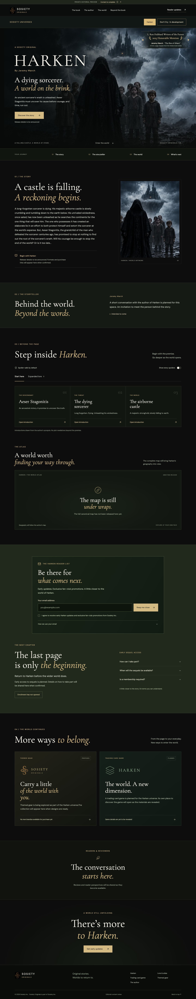

# Books & Universes

[← All Sosiety projects](README.md) · [Desktop image](books-desktop.png) · [Mobile image](books-mobile.png)

An artwork-led reader experience for **Harken**, with a shared framework for the developing **Don’t Cry** series. The design uses a dark green and gold identity, book discovery, author and story sections, introductory lore, spoiler controls, and areas for future reader updates.

The Harken and Don’t Cry experiences keep their fictional material separate. Unfinished maps, merchandise, interviews, release details, and other unavailable material are presented as pending rather than completed offerings. The recognition shown on Harken is based on the author’s supplied confirmation.

**Status:** Local website build / work in progress. This page shares screenshots; it does not offer live enrollment, purchasing, or access to unpublished manuscripts.

**Screenshot date:** September 19, 2026.

## Desktop preview

## Mobile preview

[View the full mobile screenshot →](books-mobile.png)
