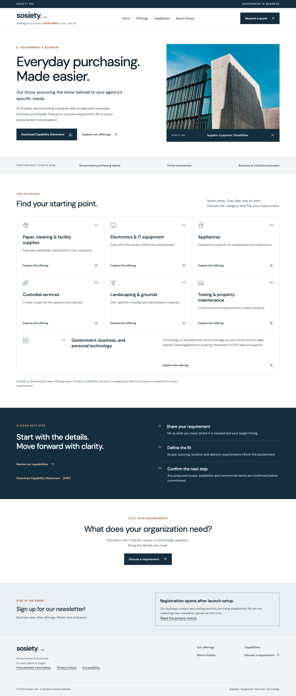

# Government & Business

[← All Sosiety projects](README.md) · [Desktop image](business-desktop.png) · [Mobile image](business-mobile.png)

A professional Sosiety website built around clear capabilities, proposed offering areas, a capability statement, procurement information, and structured requirement preparation for government and business audiences.

The interface covers supplies, equipment, property services, and technology development. Its navy and neutral palette, straightforward navigation, and capability materials support a buyer’s first review of the company’s work and direction.

**Status:** Business development website / work in progress. Offering categories are not a guarantee of availability, service coverage, registrations, certifications, supplier relationships, or delivery capacity. Actual inquiry delivery and newsletter operations require their configured services and launch setup. Buttons and forms in these images are part of the captured design, not functioning services on GitHub.

**Screenshot date:** September 19, 2026.

## Desktop preview

## Mobile preview

[View the full mobile screenshot →](business-mobile.png)
