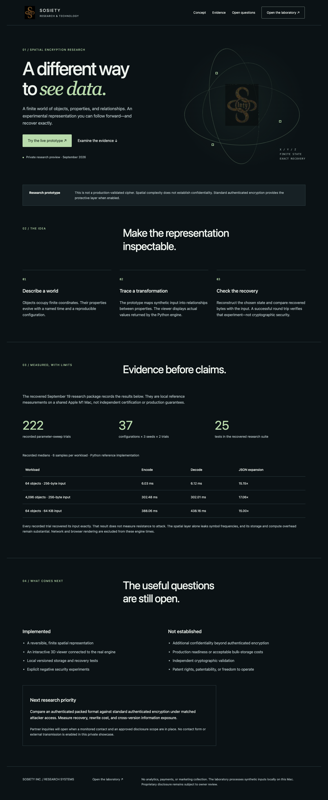

# Spatial Encryption Research

[← All Sosiety projects](README.md) · [Desktop image](spatial-desktop.png) · [Mobile image](spatial-mobile.png)

A focused technology showcase for an experimental, reversible spatial representation of data. The design explains the concept, presents recorded measurements with their limits, and identifies open research questions.

The local project includes a synthetic-data laboratory connected to the recovered research engine. This public portfolio shows the overview design; the laboratory is not hosted or executable through these GitHub screenshots.

**Status:** Research prototype. Exact recovery in recorded experiments does not establish confidentiality, superiority, production readiness, independent cryptographic validation, or patent rights. The research presentation makes those distinctions visible alongside its results.

**Screenshot date:** September 19, 2026. Measurements pictured in the overview are historical local reference results from the recovered research package, not new benchmarks run for this showcase.

## Desktop preview

## Mobile preview

[View the full mobile screenshot →](spatial-mobile.png)
